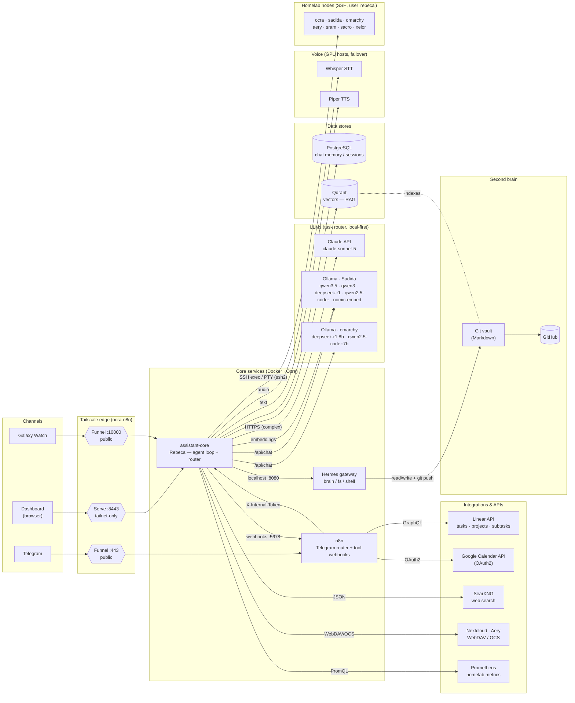

# Productivity Tools — Personal Automation Stack

A self-hosted, multi-channel personal assistant (**"Rebeca"**). You talk to it
from a **web dashboard**, a **Galaxy Watch**, or **Telegram** (text + voice
notes). At the center is **assistant-core**, a service that runs an LLM
tool-calling loop, keeps conversation memory, streams chat, proxies voice
(Whisper/Piper), and answers grounded in your **second brain** (RAG over Qdrant)
and the **live web** (self-hosted SearXNG). It uses **Claude** as the primary LLM
with a **local Ollama** fallback. **n8n** remains the integration hub (Telegram
trigger, slash-command Router, tool sub-workflows), and the **Hermes** gateway
provides low-level brain/fs/shell tools.

> **Architecture, communication diagrams, network exposure (Tailscale Serve /
> Funnel), and the Google OAuth flow are documented in
> [`docs/ARCHITECTURE.md`](docs/ARCHITECTURE.md).** The evolution plan lives in
> [`docs/REBECA_ROADMAP.md`](docs/REBECA_ROADMAP.md).

This repository is meant to be **reasonably portable**: the code and workflows
are wired to a specific home lab today, but every infrastructure-specific value
is called out in [Adapting to your own setup](#adapting-to-your-own-setup) so the
stack can be lifted onto a similar architecture.

> The infrastructure it currently runs on (Proxmox, k3s, Tailscale, NFS, GPU
> host) is documented in a separate **HomeLab** repository. This repo only owns
> the automation layer.

---

## Architecture

```
   Dashboard (tailnet)  ┐
   Galaxy Watch (funnel) ├─►  assistant-core (Rebeca, :4000)  ─►  LLM (Claude / Ollama)
   Telegram (funnel→n8n) ┘        • agent tool-calling loop         tools:
                                   • memory (Postgres)               • builtin  (web_search, RAG)
                                   • voice proxy (Whisper/Piper)     • Hermes   (brain, fs, shell)
                                   • auth gate (OAuth / tokens)      • n8n      (Linear, Calendar)

   Knowledge: second brain (git) ─► embeddings (Ollama) ─► Qdrant (RAG)
   Web:       web_search ─► self-hosted SearXNG
```

Today the stack runs as a **Docker Compose** deployment (assistant-core + n8n +
Hermes gateway + PostgreSQL + Qdrant + SearXNG + a Tailscale sidecar) on an
always-on host, reaching Ollama and the voice services on GPU hosts over Tailscale.
An optional Kubernetes manifest is included in `hermes-agent/k8s/`.

**See [`docs/ARCHITECTURE.md`](docs/ARCHITECTURE.md) for full component,
communication, network-exposure, and Google-OAuth diagrams.**

### Connection map (channels · LLMs · data · APIs)



---

## Components

| Component | Path | What it does |
| --- | --- | --- |
| **assistant-core (Rebeca)** | `assistant-core/` | Chat API + agent tool-calling loop, memory, voice proxy, auth gate; serves the dashboard and `/watch`. |
| **Dashboard** | `assistant-core/public/index.html` | Web UI: streaming chat (markdown), push-to-talk voice, model picker, slash-command autocomplete, tasks, files, homelab status, brain graph, SSH terminal, ES/EN. Tailnet-only (Serve `:8443`). |
| **Watch UI** | `assistant-core/public/watch.html` | Voice-first circular UI for the Galaxy Watch. Public Funnel `:10000` + watch token. |
| **Tool manifest** | `assistant-core/tools.manifest.json` | Declares every capability (with `category`); hot-reloaded. See `docs/ADDING_A_TOOL.md`. |
| **n8n Brain workflow (v3)** | `n8n/cerebro_workflow_v3.json` | Telegram entry point — hybrid thrifty router (see below). `cerebro_workflow_v2.json` is the legacy version. |
| **n8n tool workflows** | `n8n/tools/` | Webhook sub-workflows: `assistant_tools` (task/event), `linear_tasks` (list/projects/update/complete/create_project), `linear_whoami`, `_template`. |
| **Hermes gateway** | `hermes-agent/mcp-server/gateway.js` | HTTP server on `:8080`; brain/fs/shell tools via `POST /tool/:name`. |
| **Hermes MCP server** | `hermes-agent/mcp-server/server.js` | Native stdio MCP server (same tools) for MCP-native clients. |
| **Voice services** | `voice-services/` | Whisper (STT) + Piper (TTS) on GPU hosts (omarchy/sadida), with health-based failover. |
| **Compose stack** | `n8n/docker-compose.yaml` | assistant-core + n8n + hermes + postgres + qdrant + searxng + tailscale. |
| **Launch guide** | `LAUNCH.md` | Step-by-step bring-up. |

Hermes tools: `fs_list`, `fs_read`, `fs_write`, `fs_delete` (gated), `shell_exec`
(allowlist or unrestricted), `note_save` (git-backed notes), `ollama_chat`,
`claude_chat` (auto-falls back to Qwen when no API key or on failure). All
capabilities are **locked down by default** and enabled per-need through env
toggles (see `n8n/.env.example`).

---

## Routing model (thrifty by design)

Two layers of routing, both built to **use the cheapest thing that works** and keep
the paid model as a last resort.

### 1. Telegram entry (Brain workflow v3 — hybrid)

```
/task, /note                 → DETERMINISTIC, zero AI (dispatched straight to the tool)
free text · voice notes      → Rebeca (assistant-core)
/plan /calendar /brain /web  → Rebeca, mapped to natural language
```

Voice notes are transcribed (Whisper) and then follow the same path. All nodes
continue on error and reply with a short error message instead of failing silently.

### 2. Model router (inside assistant-core)

A **heuristic classifier** (keywords + length — no inference spent on classifying)
picks a per-turn failover chain across hosts:

| Category | Chain |
| --- | --- |
| trivial (greetings) | `qwen3:1.7b` (sadida) → `qwen3.5:4b` → Claude |
| general · tools · node commands | `qwen3.5:4b` (sadida) → Claude |
| reasoning | `deepseek-r1:8b` (omarchy) → `deepseek-r1:1.5b` (sadida) → Claude |
| coding | `qwen2.5-coder:7b` (omarchy) → `qwen2.5-coder:3b` (sadida) → Claude |
| planning / compose-new | Claude → `qwen3.5:4b` |

Ollama hosts are health-gated, so a powered-off node is skipped instantly. The
dashboard's **model picker** shows which model answered and lets you force any
discovered model (Claude stays optional). Details: [`docs/MODEL_ROUTING.md`](docs/MODEL_ROUTING.md).

---

## Capabilities

Every capability is a descriptor in `tools.manifest.json`, grouped by `category`.

| Category | Tools | Backend |
| --- | --- | --- |
| **Linear** | `create_task`, `create_plan`, `create_project`, `list_tasks`, `list_projects`, `update_task`, `complete_task` | Linear GraphQL via n8n (+ a `create_plan` builtin that composes parent + subtasks) |
| **Calendar** | `create_event`, `list_today_events` | Google Calendar via n8n (OAuth2) |
| **Notes / Brain** | `save_note`, `search_brain`, `search_brain_semantic` | Hermes → git vault; RAG via Qdrant + Ollama embeddings |
| **Web** | `web_search` | Self-hosted SearXNG |
| **Homelab** | `query_metrics` | Prometheus (PromQL) |
| **Files** | `list_files`, `create_folder`, `move_file`, `delete_file`, `share_file`, `storage_usage` | Nextcloud (WebDAV + OCS) |
| **Nodes** | `run_on_node` | SSH (ssh2) to homelab nodes as the dedicated `rebeca` user |

Behavioral guardrails: **planning** proposes the plan and waits for approval before
creating anything; **`run_on_node`** runs read-only commands directly but refuses
state-changing ones unless the user explicitly confirmed the exact command.

Planned: content drafting, progress logging, wake word, streaming TTS, file
distribution to node `Shared/` folders (see [`docs/FILES_NEXTCLOUD_PLAN.md`](docs/FILES_NEXTCLOUD_PLAN.md)).

### Note agent — git-backed Obsidian vault

The "second brain" is a plain git repository of Markdown files (an Obsidian
vault). The `note_save` Hermes tool writes a note into it and, when sync is on,
runs `git add/commit/push` so the vault stays in sync across every device via
GitHub. Configure it with `HERMES_BRAIN_*` env vars (root path, remote, branch,
optional SSH deploy key). See `LAUNCH.md`.

### Time zone

America/Puerto_Rico (UTC-04:00). assistant-core injects the current date/time into
the system prompt, so relative dates ("mañana", "el viernes") resolve correctly and
calendar events get the right ISO 8601 offset.

### Node access (SSH)

A dedicated non-root user (**`rebeca`**, in the `docker` group) with a dedicated key,
over the tailnet. Powers both the dashboard's **hub terminal** (xterm.js over a
WebSocket PTY, with live up/down lights per node) and the **`run_on_node`** tool.
Off by default — set `NODE_SSH_ENABLED=true` and mount the key. See
[`docs/ARCHITECTURE.md`](docs/ARCHITECTURE.md).

---

## Quick start

See **`LAUNCH.md`** for the full bring-up. In short:

```bash
cd n8n
cp .env.example .env      # fill in secrets (never commit .env)
sudo docker compose up -d --build
```

Then in n8n: import `cerebro_workflow_v3.json` (Telegram) and the workflows in
`n8n/tools/`, attach the Telegram / Linear / Google credentials, and **activate**
them.

Redeploying after a code change:

```bash
git pull && sudo docker compose up -d --build --no-deps assistant-core
```

Manifest-only changes hot-reload (no rebuild).

---

## Adapting to your own setup

This stack is wired to a specific home lab. To run it elsewhere, change these
infrastructure-specific values (search the repo for each):

| Value (current) | Where | Change to |
| --- | --- | --- |
| `sadida.stegosaurus-panga.ts.net:11434` (Ollama URL) | `.env.example`, `gateway.js`, `server.js`, `hermes-stack.yaml` | Your Ollama host:port. |
| `qwen3:1.7b`, `qwen3.5:4b` (models) | workflow, gateway/server defaults | Whatever models you pulled. |
| `127.0.0.1:8080` (Hermes URL in n8n) | workflow HTTP nodes | Keep `127.0.0.1` **only** if n8n and Hermes share a network namespace (Compose `network_mode: service:tailscale`). Otherwise use the service hostname. |
| Tailscale sidecar + `TS_AUTHKEY` | `docker-compose.yaml`, `.env.example` | Optional — remove the sidecar if you are not on Tailscale. |
| NFS `storageClassName: nfs-client`, `ReadWriteMany` PVC | `hermes-stack.yaml` | Your cluster's storage class (k8s path only). |
| `nodeSelector: kubernetes.io/hostname: ocra` | `hermes-stack.yaml` | Your target node (k8s path only). |
| `HERMES_BRAIN_*` (brain repo, remote, key) | `.env.example` | Your Obsidian/GitHub vault repo. |
| Linear `teamId` / `assigneeId` | `Build task`, `Linear — create project` code nodes | Your Linear team + user ids (get the user id with `n8n/tools/linear_whoami.workflow.json`). |
| Node names + hosts (`ocra`, `sadida`, …) | `assistant-core/src/ssh.js` (`DEFAULT_NODES`), `NODES` env | Your nodes and tailnet hostnames. |
| Metric queries (node_exporter + `nvidia_smi_*`) | `assistant-core/src/metrics.js`, `METRICS_PANELS` env | Your exporters' metric names. |
| `NEXTCLOUD_URL/USER/APP_PASSWORD` | `.env` | Your Nextcloud (use an app password). |

Notes worth keeping in mind when porting:

- **Do not rotate `N8N_ENCRYPTION_KEY`** on an existing n8n install — you lose
  access to stored credentials.
- Leaving `ANTHROPIC_API_KEY` **empty** is supported: Hermes falls back to the
  local Qwen model automatically.
- Secrets live in `.env` (gitignored) and in n8n credentials (Telegram, Linear,
  Google) — never in the workflow JSON.

---

## Repository structure

```
Productivity_Tools/
├── README.md                 # this file
├── HANDOFF.md                # context brief for the automation agent
├── LAUNCH.md                 # step-by-step bring-up
├── assistant-core/           # Rebeca: the brain + dashboard + watch UI
│   ├── src/                  # index, agent, llm, router, tools, memory, rag,
│   │                         #   websearch, metrics, nextcloud, ssh, auth, config
│   ├── public/               # index.html (dashboard), watch.html, favicon.svg
│   ├── tools.manifest.json   # every capability (hot-reloaded)
│   └── Dockerfile
├── n8n/
│   ├── cerebro_workflow_v3.json   # Telegram → hybrid router (current)
│   ├── cerebro_workflow_v2.json   # legacy
│   ├── tools/                     # assistant_tools, linear_tasks, linear_whoami, _template
│   ├── docker-compose.yaml        # the whole stack
│   └── .env.example
├── voice-services/           # whisper/ + piper/ (GPU hosts)
├── searxng/settings.yml      # self-hosted web search
├── docs/                     # ARCHITECTURE, REBECA_ROADMAP, MODEL_ROUTING,
│                             #   ADDING_A_TOOL, FILES_NEXTCLOUD_PLAN, STATE_OF_THE_ART_2026
└── hermes-agent/
    ├── mcp-server/           # gateway.js, server.js, Dockerfile, package.json
    ├── k8s/hermes-stack.yaml # optional Kubernetes deployment
    └── scripts/deploy.sh
```

---

## Documentation

| Doc | What's in it |
| --- | --- |
| [`docs/ARCHITECTURE.md`](docs/ARCHITECTURE.md) | Components, communication diagrams, network exposure, Google OAuth + token flows, tool dispatch, data stores. |
| [`docs/REBECA_ROADMAP.md`](docs/REBECA_ROADMAP.md) | Phases, what's done, what's next. |
| [`docs/MODEL_ROUTING.md`](docs/MODEL_ROUTING.md) | Task-specialized model routing, hosts, installed models, tuning. |
| [`docs/ADDING_A_TOOL.md`](docs/ADDING_A_TOOL.md) | How to add a capability (n8n webhook / Hermes / builtin / http). |
| [`docs/FILES_NEXTCLOUD_PLAN.md`](docs/FILES_NEXTCLOUD_PLAN.md) | Files integration + the node-distribution plan. |
| [`docs/STATE_OF_THE_ART_2026.md`](docs/STATE_OF_THE_ART_2026.md) | Local-model landscape review (Sep 2026) and upgrade candidates. |
| [`docs/PHASE1_DASHBOARD.md`](docs/PHASE1_DASHBOARD.md) | Historical — the original Phase 1 breakdown. |
