# Architecture — Rebeca

How the personal-assistant stack is wired today: the components, how each one
talks to the others, how it's exposed on the network, and how authentication and
authorization work. Diagrams are Mermaid (render on GitHub and most Markdown
viewers).

> Scope: the automation/assistant layer. Infrastructure (Proxmox, k3s, Tailscale
> admin, GPU provisioning) is owned separately.

---

## 1. Components at a glance

| Component | Runtime | Port | Network | Role |
|---|---|---|---|---|
| **assistant-core** | Node/Fastify | `4000` | shares `tailscale` netns | The brain: chat API, agent tool-calling loop, memory, voice proxy, auth gate. Serves the dashboard + `/watch`. |
| **n8n** | n8n | `5678` | shares `tailscale` netns | Integration hub: Telegram trigger, Router (slash-commands), tool sub-workflows (Linear, Google Calendar). |
| **Hermes gateway** | Node | `8080` | shares `tailscale` netns | Low-level tool provider: brain read/write (`note_save`, `brain_list`, `brain_graph`), fs/shell. |
| **Tailscale sidecar** | tailscale | — | `n8n_network` | Network namespace shared by the three above; publishes host ports and runs Serve/Funnel. Node name `ocra-n8n`. |
| **PostgreSQL** | postgres:16 | `5432` | `n8n_network` | n8n data + assistant-core chat sessions/messages. |
| **Qdrant** | qdrant | `6333` | `n8n_network` | Vector DB for RAG over the second brain. |
| **SearXNG** | searxng | `8080` | `n8n_network` | Self-hosted metasearch for the `web_search` tool. |
| **Ollama** | external | `11434` | tailnet (sadida, omarchy) | Local LLMs (task router) + embeddings (`nomic-embed-text`). |
| **Whisper (STT)** | external | `8100` | tailnet (omarchy/sadida) | Speech-to-text, preference-ordered with failover. |
| **Piper (TTS)** | external | `8200` | tailnet (omarchy/sadida) | Text-to-speech, same failover. |
| **Nextcloud** | external | — | tailnet (aery) | File storage; WebDAV + OCS for the Files widget/tools. |
| **Prometheus** | external | `9090` | tailnet (ocra) | Homelab metrics for the Homelab widget + `query_metrics`. |
| **Homelab nodes** | external | `22` | tailnet | SSH targets (`ocra`, `sadida`, `omarchy`, `aery`, `sram`, `sacro`, `xelor`) for the hub terminal + `run_on_node`. |

Clients: the **dashboard** (browser on the tailnet), the **Galaxy Watch**
(Samsung Internet over the public Funnel), and **Telegram** (text + voice notes).

### System map

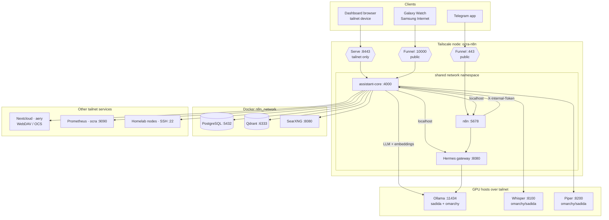

### HTTP API surface (assistant-core)

| Area | Routes |
|---|---|
| Health / meta | `GET /health`, `GET /tools`, `GET /models`, `GET /nodes`, `GET /nodes/status` |
| Chat | `POST /chat`, `POST /chat/stream`, `GET /chat/history`, `GET /chat/sessions`, `POST /chat/session/rename` |
| Tools | `POST /tools/invoke` |
| Voice | `POST /voice/transcribe`, `POST /voice/speak` |
| Widgets | `GET /widgets/calendar`, `GET /widgets/brain-graph`, `GET /widgets/homelab` |
| Files (Nextcloud) | `GET /files/list`, `GET /files/download`, `GET /files/storage`, `POST /files/upload`, `POST /files/mkdir`, `POST /files/move`, `POST /files/delete`, `POST /files/share` |
| Brain / RAG | `POST /brain/reindex`, `POST /brain/index-note` |
| Nodes | `GET /ssh/:node` (WebSocket PTY) |
| Auth / pages | `GET /auth/login`, `/auth/callback`, `/auth/logout`, `/auth/me`, `GET /watch` |

Because assistant-core, n8n and Hermes **share the Tailscale container's network
namespace** (`network_mode: service:tailscale`), they reach each other on
`localhost` (`127.0.0.1:8080`, `127.0.0.1:5678`). Postgres, Qdrant and SearXNG
live on `n8n_network`; the Tailscale container is also on that network, so the
three siblings resolve them by Docker DNS name (`postgres`, `qdrant`, `searxng`).
The GPU services are reached by Tailscale MagicDNS names.

---

## 2. Network exposure (Tailscale Serve & Funnel)

Only three ports are reachable from outside the containers, all via the Tailscale
node `ocra-n8n.stegosaurus-panga.ts.net`:

| Port | Mode | Target | Who reaches it | Purpose |
|---|---|---|---|---|
| `443` | **Funnel** (public) | `127.0.0.1:5678` (n8n) | the internet | Telegram webhook (needs public reachability). |
| `8443` | **Serve** (tailnet-only) | `127.0.0.1:4000` (assistant-core) | your tailnet devices | Dashboard (full app). |
| `10000` | **Funnel** (public) | `127.0.0.1:4000` (assistant-core) | the internet | Watch access from any network. Protected by the watch token / Google OAuth. |

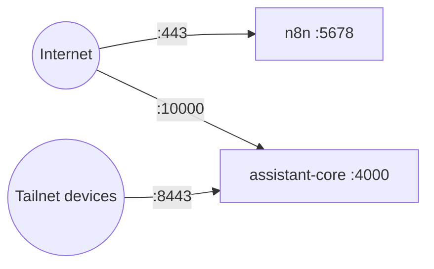

The whole app lives behind assistant-core, so both `:8443` and `:10000` hit the
same service; the difference is who can reach the port and which auth path applies
(see §5). HTTPS is terminated by Tailscale (valid `ts.net` cert), which also means
the browser mic (`getUserMedia`, secure-context only) works on both.

---

## 3. Request flow — dashboard chat

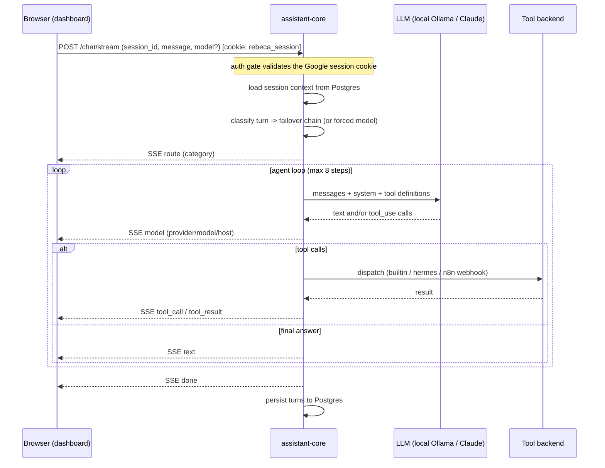

### Model routing (`router.js` + `llm.js`)

A **heuristic classifier** (keywords + length, no inference spent) maps the turn to
a category, and each category has an ordered **failover chain** across hosts.
Ollama hosts are health-gated (`GET /api/tags`, 1.5 s) so a powered-off host is
skipped instantly; on failure the next target is tried.

| Category | Chain |
|---|---|
| trivial | `qwen3:1.7b` (sadida) → `qwen3.5:4b` → Claude |
| general · explicit `/tool` · node commands | `qwen3.5:4b` (sadida) → Claude |
| reasoning | `deepseek-r1:8b` (omarchy) → `deepseek-r1:1.5b` (sadida) → Claude |
| coding | `qwen2.5-coder:7b` (omarchy) → `qwen2.5-coder:3b` (sadida) → Claude |
| planning / compose-new | Claude → `qwen3.5:4b` |

`GET /models` auto-discovers what each host has pulled; the dashboard's model
picker can force any of them (no fallback, for A/B testing) and doubles as the
"which model answered" indicator. Full detail: [MODEL_ROUTING.md](./MODEL_ROUTING.md).

---

## 4. Request flow — Telegram (Brain workflow v3, hybrid)

The Telegram entry point is **thrifty by design**: explicit `/task` and `/note` are
dispatched straight to the tool with **zero AI**; everything else goes to Rebeca,
whose own router keeps the paid model as a last resort.

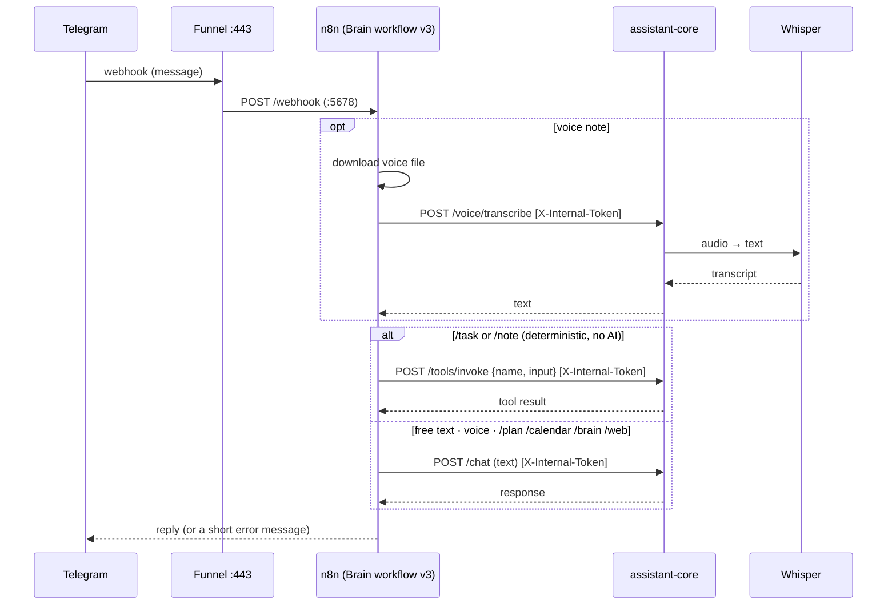

n8n calls into assistant-core with the **`X-Internal-Token`** header, which
bypasses the Google OAuth gate (service-to-service; see §5). Every HTTP node is set
to **continue on error** and the format nodes build a short `⚠️ Error: …` message,
so a failure never ends in silence.

---

## 5. Authentication & authorization

assistant-core runs a single `onRequest` gate. Three mechanisms can authorize a
request; if none applies, HTML GETs are redirected to Google login and everything
else gets `401`.

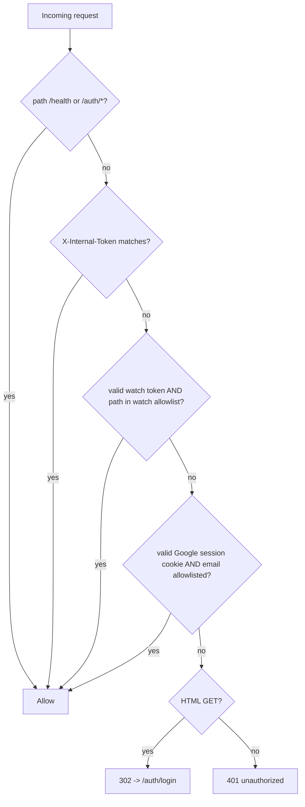

### 5a. Google OAuth (dashboard)

Login uses Google OIDC, restricted to an allowlist (`ALLOWED_GOOGLE_EMAILS`). A
signed, http-only cookie (`rebeca_session`, 7 days) carries the authenticated
email.

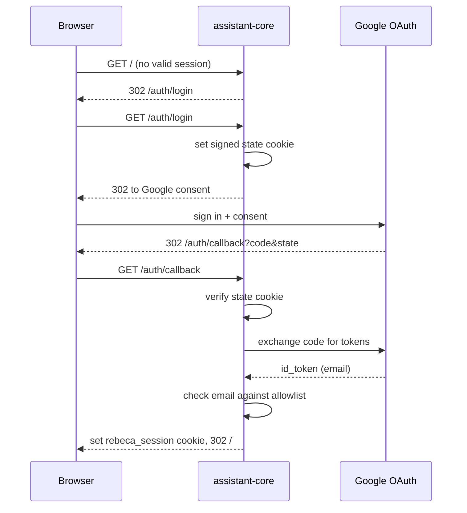

The OAuth **redirect URI is `https://ocra-n8n.stegosaurus-panga.ts.net:8443/auth/callback`**
(the tailnet Serve address). This is why the watch, which is off-tailnet, cannot
complete the Google flow and instead uses the watch token below.

### 5b. Internal token (service-to-service)

n8n/Telegram flows send `X-Internal-Token: <INTERNAL_TOKEN>`. A match bypasses the
OAuth gate entirely. Used for `POST /chat`, `/voice/transcribe`, and the brain
index hooks. The token is a shared secret in `.env`, never in workflow JSON.

### 5c. Watch token (`/watch`)

The Galaxy Watch opens `…:10000/watch?wt=<WATCH_TOKEN>`. The gate sets a signed
cookie (`rebeca_watch`, 30 days) and authorizes **only** the watch endpoints:
`/watch`, `/watch.html`, `/chat`, `/chat/stream`, `/voice/*`. Any other path still
requires Google OAuth, so a leaked watch token cannot open the full dashboard.

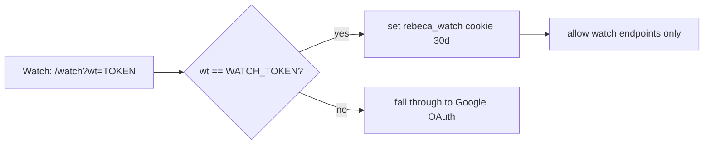

---

## 6. Tool dispatch

Every capability is a descriptor in `tools.manifest.json` (bind-mounted +
hot-reloaded). assistant-core turns each into an LLM function definition and
dispatches calls by `endpoint.type`:

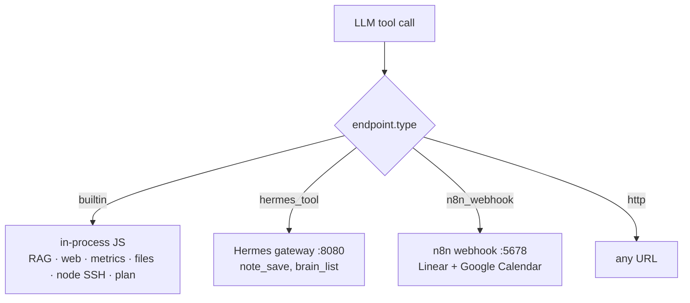

Each descriptor also carries a **`category`**, which groups it in the dashboard's
Capabilities panel and in the `/` autocomplete.

| Category | Tools | Dispatch |
|---|---|---|
| **Linear** | `create_task`, `create_plan`, `create_project`, `list_tasks`, `list_projects`, `update_task`, `complete_task` | n8n (`create_plan` is a builtin that orchestrates the others) |
| **Calendar** | `create_event`, `list_today_events` | n8n |
| **Notes / Brain** | `save_note`, `search_brain` · `search_brain_semantic` | Hermes · builtin (RAG) |
| **Web** | `web_search` | builtin → SearXNG |
| **Homelab** | `query_metrics` | builtin → Prometheus |
| **Files** | `list_files`, `create_folder`, `move_file`, `delete_file`, `share_file`, `storage_usage` | builtin → Nextcloud |
| **Nodes** | `run_on_node` | builtin → SSH |

The dashboard can also invoke any tool directly via **`POST /tools/invoke`** (used
by the task widget, the Files widget and the Ctrl-K command palette).

Two behavioral guardrails live in the system prompt + tool layer:
- **Planning** proposes the plan (project, parent, subtasks) and waits for the
  user's approval before calling `create_plan` once.
- **`run_on_node`** runs read-only commands directly, but refuses state-changing
  ones unless `confirm:true` — which the model may only send after showing the
  exact command and getting explicit approval.

Adding a tool is documented in [ADDING_A_TOOL.md](./ADDING_A_TOOL.md).

---

## 7. Data & knowledge flows

### RAG (second-brain semantic memory)

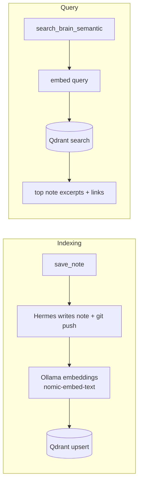

Saving a note auto-indexes it into Qdrant (incremental), so semantic search stays
fresh without a manual reindex. `POST /brain/reindex` rebuilds the whole
collection.

### Web search

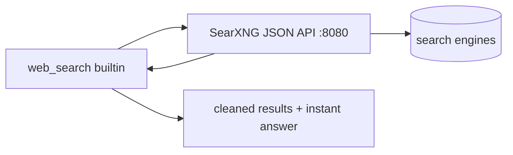

### Files (Nextcloud)

`nextcloud.js` speaks **WebDAV** (PROPFIND/GET/PUT/MKCOL/MOVE/DELETE) and **OCS**
(share links, quota) with an **app password** kept server-side, so the browser
never sees credentials and there is no CORS problem.

| Route | Used by | WebDAV/OCS |
|---|---|---|
| `GET /files/list?path=` | widget, `list_files` | PROPFIND depth 1 |
| `GET /files/download?path=` | widget | GET (streamed back) |
| `POST /files/upload?path=&name=` | widget drag & drop | PUT |
| `POST /files/mkdir` · `/files/move` · `/files/delete` | widget, tools | MKCOL · MOVE · DELETE |
| `POST /files/share` | widget, `share_file` | OCS share → public link |
| `GET /files/storage` | `storage_usage` | OCS quota |

### Homelab metrics

`metrics.js` runs **PromQL** against Prometheus. `GET /widgets/homelab` returns
per-service health (one entry per host for multi-host services like Ollama,
Whisper and Piper) plus per-node panels (CPU, RAM, Disk, GPU, VRAM) built from
`node:cpu_utilization:ratio`, `node:memory_utilization:ratio`,
`node_filesystem_*` and `nvidia_smi_*`. Override the panels with `METRICS_PANELS`.

### Node access (SSH)

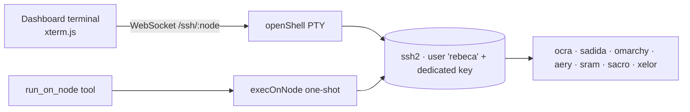

- Connects as a **dedicated non-root user** (`rebeca`, in the `docker` group) with a
  dedicated key, over the tailnet, only to nodes in the registry.
- `GET /nodes` lists the registry; `GET /nodes/status` does a quick TCP :22 probe
  for the terminal's green/red lights.
- Disabled unless `NODE_SSH_ENABLED=true` and the key is mounted at
  `/app/.ssh/nodes_key`.
- Commands are classified read-only vs mutating (`isReadOnly`), including rejecting
  chained commands that hide a mutation behind a safe prefix.

---

## 8. Persistence

| Store | Holds | Notes |
|---|---|---|
| **PostgreSQL** | `chat_session`, `chat_message` | Per-channel conversation memory; migration retries on cold boot. |
| **Qdrant** | `brain` collection (vectors) | RAG over the vault; 768-dim (`nomic-embed-text`). |
| **Second brain (git)** | Markdown vault | Written by Hermes `note_save`, pushed to GitHub. |
| **Nextcloud (aery)** | user files | Reached over WebDAV/OCS with an app password. |
| **`.env`** | secrets | OAuth, internal token, watch token, DB password, TS authkey, Nextcloud app password, SSH key path. Never committed. |
| **Tailscale state volume** | Serve/Funnel config, node identity | Survives restarts. |

---

## 9. Client channels summary

| Channel | Entry | Auth | Voice |
|---|---|---|---|
| Dashboard | Serve `:8443` (tailnet) | Google OAuth | mic push-to-talk + TTS |
| Watch | Funnel `:10000` (public) | Watch token | mic push-to-talk + TTS |
| Telegram | Funnel `:443` → n8n | Internal token | voice notes in; text out |

---

## 10. Dashboard surface

One page (`public/index.html`), everything behind the OAuth gate:

- **Chat** — SSE streaming with rendered markdown (tables, code), "thinking"
  indicator, push-to-talk mic + TTS, conversation switcher (search, rename),
  `/` slash-command autocomplete grouped by category with hover help, and a
  **Ctrl-K command palette** that can run any tool with a small form.
- **Model picker** — combined selector + "which model answered" indicator.
- **Widgets** — upcoming events, tasks (grouped by project, subtasks nested, with
  an expanded manager modal for inline edits), homelab (services + per-node
  resources), second brain graph (search + center), capabilities, files.
- **Node terminal** — xterm.js over the `/ssh/:node` WebSocket, with per-node
  status lights.
- **i18n** — ES/EN toggle for the whole UI, persisted in `localStorage`.
